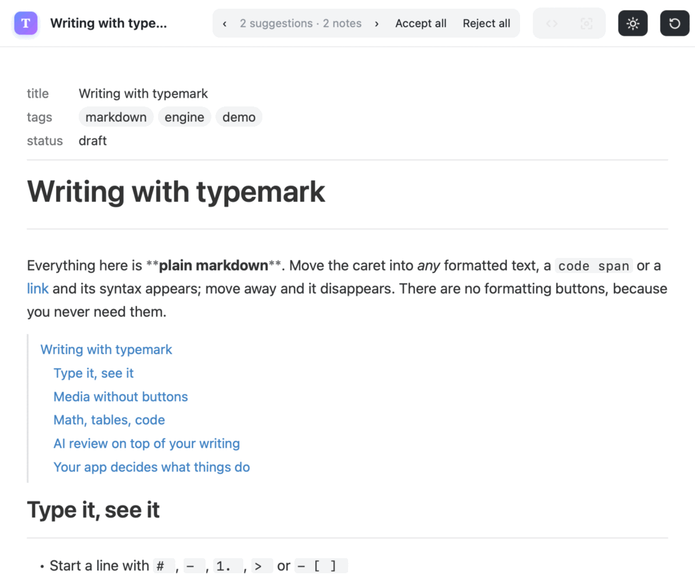
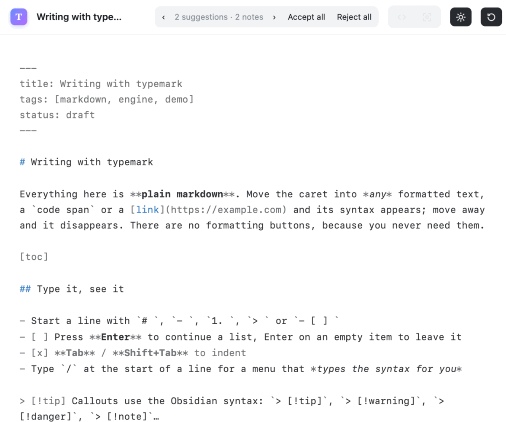
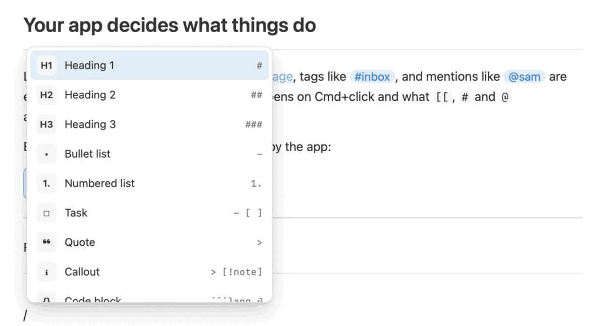
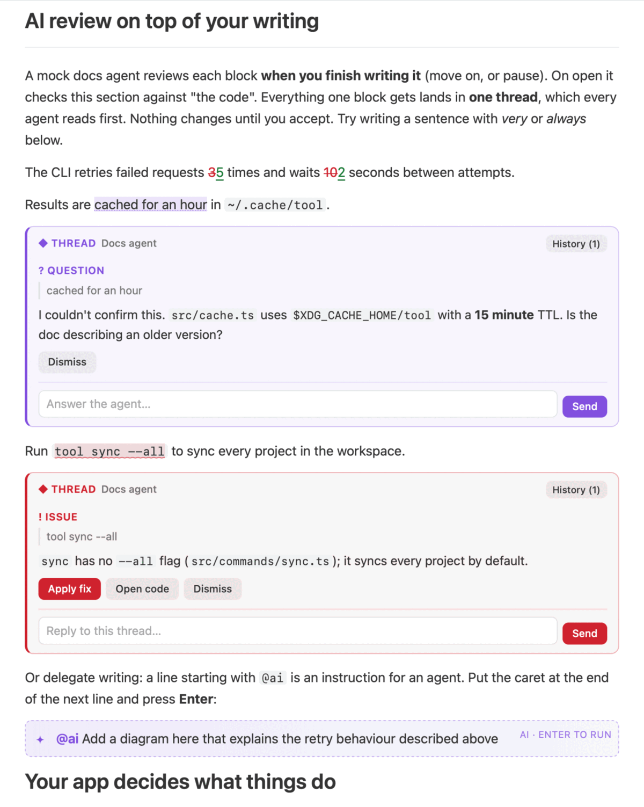
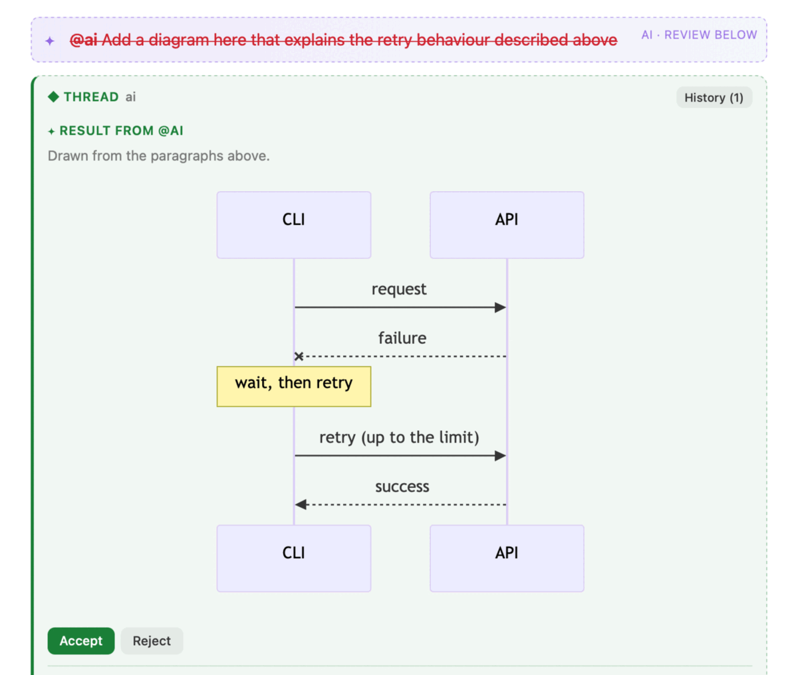
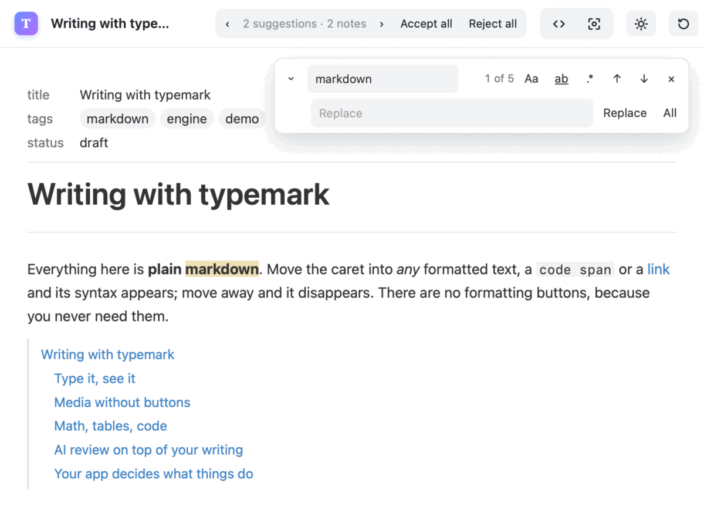
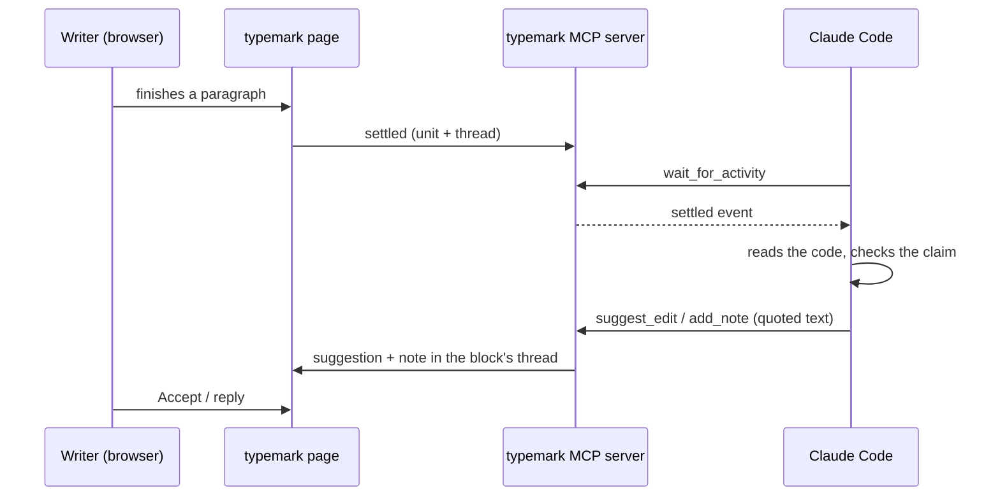

<p align="center">
  
</p>

<h1 align="center">typemark</h1>

<p align="center">
  <b>Seamless markdown editing, with room for AI reviewers.</b><br>
  A framework-free engine: you see a rendered document, and markdown syntax appears only where your caret is.<br>
  The document is always plain markdown. AI agents review it like a Google Docs collaborator.
</p>

<p align="center">
  <a href="https://www.npmjs.com/package/@caronex/typemark"></a>
  <a href="LICENSE"></a>
  
</p>

<picture>
  <source media="(prefers-color-scheme: dark)" srcset="docs/screenshots/hero-dark.png">
  
</picture>

## Why

- **Seamless.** Typora-style live preview: `**bold**` looks bold; its `**` appear only while the caret is next to
  it. No split panes, no toolbars. Every feature has markdown syntax you type.
- **Markdown is the source of truth.** No JSON document model. What you save is what you wrote, byte for byte.
- **AI-ready, model-free.** A review layer for agents: Google-Docs-style suggested edits, agent questions and
  issues anchored to text, one thread per block shared by every agent, `@ai` instruction blocks. Your app (or
  Claude Code, via the included plugin) supplies the intelligence.
- **Small and embeddable.** Vanilla TypeScript, works in any framework or none. ~50 KB gzipped + KaTeX/highlight.js.
- **Extensible.** Your own inline syntax, blocks, widgets, buttons and autocomplete, without forking.
- **MIT licensed.** Free for everything.

## Features

| | |
|---|---|
| **Live preview** headings, emphasis, links, lists, tasks, nested quotes, tables, footnotes, front matter as a properties panel | **Source mode**: the same page with every markdown character visible, still editable |
|  |  |
| **Syntax-first**: `/` opens a menu that *types the markdown for you* | **Media by syntax**: images (`` + Enter opens a file picker, paste, drop), `@[title](url)` embeds, Mermaid, KaTeX |
|  |  |
| **AI review**: suggested edits, agent questions and issues, one thread per block | **`@ai` instructions**: write an instruction, press Enter, review the agent's result |
|  |  |

Also: callouts (`> [!tip]`, foldable), `+++` toggle blocks, heading folding, link cards, `[toc]`, find & replace
(regex), typing aids (auto-pairs, wrap selection, smart dashes), clean paste from Google Docs/Word/web, focus
mode, light/dark themes, a headless metadata API (tasks, tags, backlinks), and accessibility (screen-reader
announcements, keyboard-only review).



## Install

```bash
npm install @caronex/typemark
```

Or with no build step (one ES module with its dependencies bundled):

```html
<link rel="stylesheet" href="https://cdn.jsdelivr.net/npm/katex@0.16.11/dist/katex.min.css">
<link rel="stylesheet" href="https://cdn.jsdelivr.net/npm/@caronex/typemark@0.4.0/dist/style.css">
<div id="editor"></div>
<script type="module">
  import { createEditor } from "https://cdn.jsdelivr.net/npm/@caronex/typemark@0.4.0/dist/typemark.standalone.js";
  createEditor(document.querySelector("#editor"), { value: "# Hello\n\nStart *writing*." });
</script>
```

See [`examples/cdn.html`](examples/cdn.html).

## Quick start

```ts
import { createEditor } from "@caronex/typemark";
import "@caronex/typemark/style.css";

const editor = createEditor(document.querySelector("#editor")!, {
  value: "# Hello\n\nStart *writing*.",
  placeholder: "Start writing…  (type / for syntax)",
  onChange: (markdown) => save(markdown),
  uploadImage: async (file) => (await upload(file)).url, // paste / drop /  + Enter
});

editor.getMarkdown();       // the document
editor.setSourceMode(true); // show the markdown in place
editor.getMetadata();       // title, tasks, tags, links, outline...
```

### React

```tsx
function MarkdownEditor({ value, onChange }: { value: string; onChange(md: string): void }) {
  const ref = useRef<HTMLDivElement>(null);
  const cb = useRef(onChange);
  cb.current = onChange;
  useEffect(() => {
    const ed = createEditor(ref.current!, { value, onChange: (md) => cb.current(md) });
    return () => ed.destroy();
  }, []); // the editor owns the document after mount; call ed.setMarkdown to replace it
  return <div ref={ref} />;
}
```

## Syntax

Everything is typed. Syntax this engine invented is marked ★.

| You type | You get |
|---|---|
| `# `, `## ` … | headings |
| `- `, `1. `, `- [ ] ` | lists and tasks (Enter continues, Tab indents) |
| `> `, `> > ` | quotes, nested |
| `> [!note] ` / `tip` `info` `success` `warning` `danger` `bug` `example` `quote` `todo` | callouts (Obsidian syntax); the `> ` lines right under one are its body |
| `> [!note]- T` / `> [!note]+ T` | foldable callout, starts collapsed / expanded (chevron toggles the view, not the marker) |
| ★ `+++ Title` … `+++` | toggle block: the blocks between the fences are its body (Enter on an unclosed `+++ Title` adds the closing fence). Same syntax as Linear's collapsible sections, readable as plain text, no HTML |
| ★ `https://…` alone on a line | link card; metadata comes from the host's `linkPreview(url)` option (host + URL without it) |
| hover a heading's chevron, Cmd/Ctrl+Alt+`[` / `]` | fold / unfold a heading section (view state only) |
| `**b**` `*i*` `` `c` `` `~~s~~` `==h==` `[t](url)` | inline formatting |
| `` | image; ★ press **Enter** inside an empty `` to pick a file; paste/drop an image to upload |
| ★ `@[title](url)` | embed: YouTube, Vimeo, Loom, CodePen, Figma, audio/video files, any https page (sandboxed) |
| `<iframe …>`, `<video …>` | raw embeds (attribute-whitelisted) |
| ```` ```lang ```` + Enter | code block (highlighted); ```` ```mermaid ```` renders a diagram |
| `$x$`, `$$` + Enter | math (KaTeX) |
| `\| a \| b \|` + Enter | table (Tab moves between cells) |
| ★ `[toc]` | live table of contents |
| `[^1]` / `[^1]: text` | footnotes |
| `---` at the top … `---` | front matter, shown as a properties panel |
| `/` at line start | menu that **types the syntax for you** |

## Keyboard

| keys                       |                                                       |
|----------------------------|-------------------------------------------------------|
| Cmd/Ctrl + B / I / E       | bold / italic / inline code                           |
| Cmd/Ctrl + Z, Shift+Cmd+Z  | undo / redo                                           |
| Enter                      | new block; continues lists and quotes; ends an empty item |
| Shift + Enter              | soft line break                                       |
| Tab / Shift + Tab          | indent list item · next/previous table cell           |
| `| a | b |` + Enter        | create a table                                        |
| ```` ```lang ```` / `$$` + Enter | open a code / math block                        |
| Cmd/Ctrl + click           | follow link · jump to footnote                        |

Copy produces markdown. Paste converts rich HTML (web pages, Google Docs, Word) to clean markdown;
Cmd/Ctrl+Shift+V pastes plain text (multi-line paste becomes blocks). Pasting a URL over a selection makes `[selection](url)`.

**Typing aids** (option `typingAids`, default on; `false` or `{ wrap, pairs, smartPunctuation }` to tune;
never inside code/math blocks, front matter or inline code):
typing ``* _ ` ~ = [ ( "`` over a selection wraps it (type `*` twice for bold); `( [ {` and backtick
auto-close before whitespace/punctuation, typing the closer steps over it and Backspace removes an
empty pair; ` -- ` becomes ` — ` and `...` becomes `…`.

## Extensions

Extensions declare **syntax** and **hooks**; markdown stays the only source of truth, and the engine keeps owning
editing, caret, undo and rendering. Register them for the page with `registerExtension(ext)` (returns an
unregister function; call `editor.refresh()` if the editor already exists).

| Kind | Use for | You provide |
|---|---|---|
| **inline** | `[[links]]`, `#tags`, `@mentions`, issue keys, dates | `trigger`, `pattern`, `parts` (which slices are syntax), `data`, `onClick`, `decorate` |
| **prefix block** | callouts, admonitions, custom block styles | `prefix` regex, `data`, `continuation` |
| **widget block** | buttons, link cards, queries, charts, embeds | ```` ```fence ```` or one-line `pattern`, `render(ctx)` drawing into `ctx.el`, `ctx.setSource()` to persist state |
| **suggester** | `/` menu items, `[[` / `@` / `:` autocomplete | `trigger`, `items(query)` → `{ label, detail, icon, apply }` |

### Built-ins with your behaviour

```ts
import { registerExtension, wikilinks, tags, mentions, actionButtons } from "@caronex/typemark";

registerExtension(wikilinks({ onOpen: (t) => router.open(t), exists: (t) => notes.has(t), suggest: (q) => notes.search(q) }));
registerExtension(tags({ onOpen: (t) => search("#" + t) }));
registerExtension(mentions({ onOpen: (u) => profile(u), suggest: (q) => users(q) }));
registerExtension(actionButtons({ onAction: ({ action, args }, { editor }) => run(action, args) }));
```

A button is written in the document and coded by the app:

````md
```button
label: Deploy preview
action: deploy
env: staging
```
````

### Inline syntax: issue keys that link to your tracker

```ts
registerExtension({
  name: "issues",
  inline: [{
    name: "issue",
    trigger: "",                        // any position; the pattern decides
    pattern: /\b([A-Z]{2,6}-\d+)\b/,
    data: (m) => ({ key: m[1] }),
    onClick: (d) => window.open(`https://linear.app/acme/issue/${d.key}`),
    modClick: true,                     // Cmd/Ctrl+click, so plain clicks still place the caret
    decorate: (el, d) => (el.title = `Open ${d.key}`),
  }],
  css: `.md-x-issue { color: var(--tm-accent); font-family: ui-monospace, monospace; }`,
});
```

`parts` splits a match into visible text and hidden syntax, e.g. `[[Page|alias]]` shows only `alias` until the caret
arrives. Parts must add up to the matched text; otherwise the extension is ignored.

### Prefix block: `!!! warning` admonitions

```ts
registerExtension({
  name: "admonition",
  blocks: [{
    kind: "prefix",
    name: "admonition",
    prefix: /^!!! (\w+) /,
    data: (src) => ({ level: src.match(/^!!! (\w+)/)![1] }),
  }],
  css: `.md-custom[data-ext="admonition"] { border-left: 4px solid orange; padding-left: 1em; }`,
});
```

### Widget block: a live chart from a fenced block

````ts
registerExtension({
  name: "chart",
  blocks: [{
    kind: "widget",
    name: "chart",
    fence: "chart",                     // ```chart … ```
    render({ el, body }) {
      const rows = body.split("\n").map((l) => l.split(":")).filter((r) => r.length === 2);
      el.innerHTML = rows
        .map(([k, v]) => `<div>${k} <span style="display:inline-block;width:${+v * 4}px;height:10px;background:var(--tm-accent)"></span> ${v}</div>`)
        .join("");
    },
  }],
});
````

Widgets can keep their state in the markdown with `ctx.setSource(next)` (undoable), e.g. a counter
`{{count:3}}` whose button rewrites itself to `{{count:4}}`. Anything a widget draws lives in a `[data-tm-ui]`
mount and never becomes document text. Set `live: true` to re-render on every document change (like `[toc]`).

### Suggester: `:emoji:` autocomplete

```ts
const EMOJI = { tada: "🎉", rocket: "🚀", eyes: "👀", check: "✅" };
registerExtension({
  name: "emoji",
  suggesters: [{
    name: "emoji",
    trigger: ":",
    items: (q) => Object.entries(EMOJI)
      .filter(([k]) => k.startsWith(q))
      .map(([k, e]) => ({ label: `${e} ${k}`, apply: e })),
  }],
});
```

Add items to the `/` menu with `registerExtension(slashMenu([...extraItems]))`.

### Fence renderers: any ```` ```lang ```` as a live preview

```ts
import { registerFenceRenderer, mermaidRenderer } from "@caronex/typemark";

createEditor(el, { renderers: { mermaid: mermaidRenderer(() => import("mermaid")) } });

registerFenceRenderer("dot", async (code, target) => {
  target.innerHTML = await myGraphviz(code);   // render into a shadow root: adds no text to the document
});
```

## AI review layer

typemark has no model inside. Your app (or Claude Code through the [plugin](#use-it-from-claude-code)) runs agents
and drives `editor.ai`. Nothing changes in the document until the writer accepts.

```ts
const editor = createEditor(el, {
  value,
  ai: {
    // cadence is yours: review every block the writer finishes
    onUnitSettled: async (unit, { thread }) => {
      const review = await myModel.review(unit.markdown, thread?.history); // thread = what other agents already said
      for (const s of review.edits) editor.ai.suggestEdit(unit.from + s.from, unit.from + s.to, s.text, { author: "Style agent", reason: s.why });
    },
    // `@ai …` lines the writer runs with Enter
    onInstruction: async (job) => {
      const h = job.stream({ reason: "Drafted from the section above" });
      for await (const chunk of myModel.stream(job.instruction, job.context)) h.append(chunk);
      h.finish();
    },
  },
});
```

| What | API | Looks like |
|---|---|---|
| Suggested edits (word diff, accept/reject, accept all = one undo) | `ai.suggestEdit(from, to, text, { author, reason })` | struck original + green insertion |
| New content | `ai.suggestBlocks(after, markdown)` / `ai.suggest({ ..., streaming: true })` | phantom block with Accept / Reject |
| Agent questions and issues | `ai.addNote({ from, to, kind: "question" \| "issue" \| "info" \| "success", body, actions })` | card in the block's thread, reply box |
| One thread per block | `ai.getThread(at)`, `ai.getThreads()`, `onThreadReply` | history of every suggestion, note, reply, accept, reject |
| `@ai` instructions | `onInstruction(job)` → `job.resolve(md)` / `stream()` / `ask(q, cb)` / `fail(msg)` | instruction struck, result proposed |
| Comments | `ai.addComment({ from, to, data })`, `restoreComments(saved)` | highlight; re-anchors by quote on load |
| Review marks | `ai.setMarks(source, [{ from, to, severity, message, fixes }])` | squiggles with one-click fixes |
| Cadence | `onUnitSettled`, `settleMs`, `getDirtyUnits()`, `markReviewed()` | per block, per pause, or your own timer |
| Prompt context | `ai.getContext({ from, to })` | text before/after, selection, heading path |
| Provenance | `ai: { markAccepted: true }` | AI-written text tinted |

A *unit* is a block, or a tight run of blocks that belong together (a list with nested items, consecutive
quote lines). Every unit has at most one thread, so agents working on the same block see each other's work and
don't repeat or contradict it.

## Metadata API

Pure functions: no DOM, works on a server or in a worker.

```ts
import { extractMetadata, buildBacklinks } from "@caronex/typemark";

const m = extractMetadata(markdown);
m.title; m.frontmatter?.data;          // properties
m.tasks; m.taskSummary;                // [{ text, done, depth, section, line }], { total, done, open }
m.tags; m.mentions; m.wikilinks; m.links; m.images; m.embeds;
m.headings; m.footnotes.missing; m.instructions; m.stats.words;

const { backlinks, unresolved } = buildBacklinks({ "roadmap.md": md1, "release.md": md2 });
backlinks["roadmap.md"]; // [{ source: "release.md", kind: "wikilink", line, context }]
```

`editor.getMetadata()` returns the same for the live document.

## Use it from Claude Code

This repo is a Claude Code plugin marketplace. The plugin teaches Claude to build writing tools on typemark and
gives it MCP tools to **review a live document while you write**.

```text
/plugin marketplace add Caronex-Labs/typemark
/plugin install typemark@typemark
```

### Build things with it

Ask in plain words; the skill makes Claude use typemark (CDN build, syntax-first, no formatting toolbars):

> Build me a journaling app as a single HTML page. Entries are markdown, with a sidebar of past days and tags.

> Make an artifact for drafting release notes, with a `[toc]`, callouts, and a word count in the header.

> Add a markdown editor to our settings page for the "About" field, and save it on blur.

### Let Claude review as you write

Connect the page to the local bridge (127.0.0.1 only; localhost pages only by default):

```ts
import { connectAgent } from "@caronex/typemark";
connectAgent(editor, { docId: "api-docs" }); // ws://127.0.0.1:4799
```

Then, in Claude Code, in the repository the document describes:

> Review my API docs against the code as I write. Check every block I finish, cite file:line, and ask me when
> something is ambiguous.

> Fact-check the open document and mark anything you can't verify.

> Watch my draft. When I write an `@ai` line, do what it says.



| Tool | |
|---|---|
| `list_documents`, `read_document`, `get_thread` | what's open, its markdown, outline, dirty blocks, every thread |
| `suggest_edit`, `suggest_blocks` | Google-Docs-style suggestions, phantom blocks |
| `add_note`, `reply_in_thread`, `add_comment`, `set_marks` | questions, issues, replies, comments, squiggles |
| `resolve_instruction` | answer an `@ai` block (result, question, or failure) |
| `wait_for_activity`, `mark_reviewed` | blocks you finish, your replies, `@ai` runs |

Tools anchor by **quoting text**, which is how a model naturally refers to a document. Document content is passed
to Claude as untrusted data. Settings: `TYPEMARK_BRIDGE_PORT` (default 4799), `TYPEMARK_ALLOWED_ORIGINS`.

## API reference

### `createEditor(element, options?) → Editor`

| option          | type                           | default |                                                        |
|-----------------|--------------------------------|---------|--------------------------------------------------------|
| `value`         | `string`                       | `""`    | initial markdown                                       |
| `onChange`      | `(markdown: string) => void`   |         | after every edit                                       |
| `onStateChange` | `(state: EditorState) => void` |         | caret moved or doc changed (deduplicated)              |
| `placeholder`   | `string`                       |         | shown while empty                                      |
| `readOnly`      | `boolean`                      | `false` | render only                                            |
| `spellcheck`    | `boolean`                      | `true`  |                                                        |
| `uploadImage`   | `(file) => Promise<url>`       | data URL | store pasted / dropped / picked images                |
| `resolveImageUrl` | `(src) => url`               |         | map markdown srcs (e.g. relative paths) to loadable URLs |
| `embedPolicy`   | `(url: URL) => boolean`        | https, cross-origin | which embeds may load                      |
| `renderers`     | `Record<lang, FenceRenderer>`  |         | e.g. `{ mermaid: mermaidRenderer(() => import("mermaid")) }` |
| `coreExtensions`| `boolean`                      | `true`  | register embeds, `[toc]`, callouts, `/` menu           |

### `Editor`

| method                    |                                                             |
|---------------------------|-------------------------------------------------------------|
| `getMarkdown()`           | the document as markdown                                    |
| `setMarkdown(md)`         | replace the document; clears undo history                   |
| `exec(command)`           | run a command at the caret (see below)                      |
| `getState()`              | `EditorState` at the caret                                  |
| `setReadOnly(b)` / `isReadOnly()` |                                                     |
| `focus()`                 | caret to end of document                                    |
| `setSourceMode(b)` / `isSourceMode()` | show every markdown character in place (still editable) |
| `setFocusMode(b)`         | fade all blocks but the current one                         |
| `getStats()`              | `{ words, characters, readingMinutes }`                     |
| `getBlocks()` / `updateBlock(id, src)` | read / replace blocks (undoable)               |
| `getHeadings()` / `revealBlock(id)` | outline and navigation                            |
| `getFrontmatter()` / `setFrontmatter(yaml \| null)` | document properties                  |
| `insertImages(files, at?)` / `pickImage()` | upload through `uploadImage`               |
| `refresh()`               | re-render after registering extensions on a live editor     |
| `fold(id)` / `unfold(id)` / `toggleFold(id)` / `isFolded(id)` | collapse headings, callouts, `+++` toggles (view state) |
| `getFolds()` / `setFolds(ids)` | folded block ids (ids live for the session; re-map after `setMarkdown`) |
| option `linkPreview`      | `(url) => Promise<{title, description, image, siteName, favicon} \| null>`; cached per URL |
| `undo()` / `redo()`       |                                                             |
| `destroy()`               | remove all listeners; rendered content stays                |
| `root`                    | the element                                                 |

### Commands

```ts
type Command =
  | { type: "bold" | "italic" | "code" | "strike" | "highlight" } // wrap/unwrap selection
  | { type: "heading"; level: 0 | 1 | 2 | 3 | 4 | 5 | 6 }        // 0 = paragraph
  | { type: "bulletList" | "orderedList" | "taskList" | "quote" } // same command again toggles off
  | { type: "codeBlock" | "mathBlock" | "table" | "hr" }          // insert
  | { type: "image"; src: string; alt?: string } | { type: "imagePicker" }
  | { type: "embed"; url: string }                                // inserts @[](url)
  | { type: "diagram"; lang?: string }                            // fenced block for a renderer
  | { type: "insertText"; text: string; caret?: number }
  | { type: "insertBlock"; src: string; caret?: number }
  | { type: "undo" | "redo" };
```

Commands exist for apps that need them (menus, shortcuts, AI insertions); writers never need a toolbar.

### `EditorState`

```ts
{ block: BlockType | null; headingLevel: number; formats: InlineFormat[]; canUndo: boolean; canRedo: boolean }
```

### Lower-level exports

`parse(md) → Block[]`, `serialize(blocks) → md`, `renderBlock(src)`, `renderInline(src)`, `blockType(src)` —
useful for rendering markdown read-only with exactly the editor's look (wrap output in an element with class
`tm-editor`).

## Accessibility

- The editor root is `role="textbox"` with `aria-multiline`, an `aria-label` (option `ariaLabel`, default "Markdown editor") and `aria-readonly`.
- A visually hidden polite live region (`editor.liveRegion`) announces block conversions ("Heading 2", "Bulleted list"), undo/redo, source mode, task toggles and AI events (suggestion added/accepted/rejected, notes with kind and author, replies, comments). Hosts can speak through it with `editor.announce(text)`.
- When the caret enters a highlight-only review range (inline deletion/replacement, comment, mark) its meaning is announced, since CSS highlights are invisible to assistive tech.
- Task checkboxes are `role="checkbox"` with `aria-checked` and the task text as label. Image `alt` comes from the markdown.
- The suggestion menu is a `listbox`; the editor carries `aria-expanded`, `aria-controls` and `aria-activedescendant` while it is open. Escape closes it and focus stays in the editor.
- AI thread cards are labelled `group`s (authors, note and suggestion counts); every action is a real button.
- The find panel is a `search` landmark with labelled inputs and a live match count ("3 of 12").
- Visible `:focus-visible` rings on engine buttons and inputs; `prefers-reduced-motion` disables shimmer, blink and slide animations; `--tm-meta` (syntax characters, placeholder) meets 4.5:1 in light and dark.

| Shortcut | Action |
| --- | --- |
| Cmd/Ctrl+Enter | Toggle the task on the caret line |
| Alt+Shift+T | Move focus into the current block's review thread card |
| Esc (in a thread card) | Return focus to the caret |
| Esc (suggestion menu) | Close the menu |

## Theming

Everything lives under `.tm-editor`. Override the custom properties (light and dark are built in; force one with
`data-theme="light|dark"` on any ancestor):

```css
.tm-editor {
  --tm-fg: #333; --tm-bg: #fff; --tm-meta: #737373; --tm-accent: #4183c4;
  --tm-code-bg: #f3f4f4; --tm-quote: #777; --tm-border: #dfe2e5;
  max-width: 860px; padding: 40px 30px 40vh; /* page layout: override freely */
}
```

## How it works

The model is a list of blocks, each holding its raw markdown. Rendering keeps **every markdown character in the
DOM**: syntax is wrapped in `<span class="md-meta">` and hidden by CSS, so a block's text always equals its markdown.

1. Plain typing is left to the browser (fast; IME and autocorrect work).
2. On `input`, the block's text *is* its new source; it is re-rendered, and the DOM is touched only if the HTML changed.
3. The caret is restored by character offset; the block gets `.md-focus` (shows `# `, `- `) and every inline element
   touching the caret gets `.md-expand` (shows `**`, `` ` ``, `[..](..)`).
4. Structural edits (Enter, merges, cross-block selections, paste, undo) are model operations, never browser ones.

Things that add pixels but no text never count as document text: KaTeX and diagram previews (shadow DOM), images,
checkboxes, embeds, widgets and AI cards (`[data-tm-ui]` mounts). Review highlights use the CSS Custom Highlight
API, so suggestions, comments and marks never touch the document's DOM. Source mode is the same DOM with every
`md-meta` span shown.

## Develop

```bash
npm install
npm run dev        # demo at http://localhost:5173 (index.html + demo/)
npm test           # vitest (jsdom), 140+ tests
npm run build      # dist/: typemark.js, typemark.standalone.js, style.css, *.d.ts
cd mcp && npm install && npm run build   # bundles the MCP server into claude-plugin/server/
```

## License

[MIT](LICENSE) © Sameeran Bandishti / Caronex Labs
