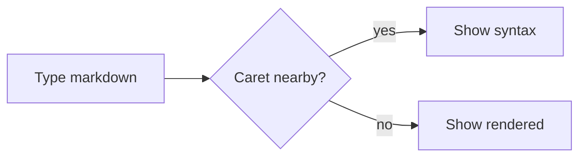

# Writing with typemark

Everything here is **plain markdown**. Move the caret into *any* formatted text, a `code span` or a [link](https://example.com) and its syntax appears; move away and it disappears. There are no formatting buttons, because you never need them.

[toc]

## Type it, see it

- Start a line with `# `, `- `, `1. `, `> ` or `- [ ] `
- [ ] Press **Enter** to continue a list, Enter on an empty item to leave it
- [x] **Tab** / **Shift+Tab** to indent
- Type `/` at the start of a line for a menu that *types the syntax for you*

> [!tip] Callouts use the Obsidian syntax: `> [!tip]`, `> [!warning]`, `> [!danger]`, `> [!note]`…

> [!warning] Everything you see is stored as markdown. Toggle **Source** in the top bar to watch it.

## Media without buttons

Type `` to pick a file. You can also paste or drop images anywhere.


Embeds use `@[title](url)`: YouTube, Vimeo, Loom, CodePen, Figma, audio or video files.

@[Big Buck Bunny](https://www.youtube.com/watch?v=aqz-KE-bpKQ)

Diagrams are fenced `mermaid` blocks; click the diagram to edit it.



## Math, tables, code

Inline $e^{i\pi} + 1 = 0$, or a block:

$$
\int_0^\infty e^{-x^2}\,dx = \frac{\sqrt{\pi}}{2}
$$

| Syntax | Becomes | Notes |
|:--|:--:|--:|
| `` + Enter | image picker | paste a URL instead |
| `@[](url)` | embed | sandboxed |
| `[toc]` | outline | live |

```ts
const editor = createEditor(el, { value, onChange });
```

## AI review on top of your writing

Press **Review** in the top bar: a mock docs agent checks this section against "the code" and answers with suggested edits, questions and issues, all anchored to the text below. Nothing changes until you accept.

The CLI retries failed requests 3 times and waits 10 seconds between attempts.

Results are cached for an hour in `~/.cache/tool`.

Run `tool sync --all` to sync every project in the workspace.

Or delegate writing: a line starting with `@ai` is an instruction for an agent. Put the caret at the end of the next line and press **Enter**:

@ai Add a diagram here that explains the retry behaviour described above

## Your app decides what things do

Links to notes like [[Project ideas]] or [[Missing page]], tags like #inbox, and mentions like @sam are extensions: the host app supplies what happens on Cmd+click and what `[[`, `#` and `@` autocomplete with.

Buttons are widgets whose action is coded by the app:

```button
label: Insert timestamp
action: timestamp
```

---

Footnotes work too.[^1]

[^1]: Cmd+click a footnote marker to jump here.
